# Project Requirement Document (PRD)

## TomatSehat: Sistem Monitoring Kesehatan Tanaman Tomat Berbasis Deteksi Penyakit Daun

| Atribut | Isi |
|---|---|
| Mata kuliah | Proyek 3, Semester 5, D4 Teknik Informatika, ULBI |
| Jenis luaran | Aplikasi web berarsitektur microservices (frontend + backend API) |
| Versi dokumen | 1.1 (Draft untuk review) |
| Tanggal | 19 Oktober 2026 |
| Penyusun | (isi nama tim) |
| Nama aplikasi | **TomatSehat** (usulan, dapat diganti sebelum M2) |

| Versi | Tanggal | Perubahan |
|---|---|---|
| 1.0 | 18 Oktober 2026 | Penyusunan awal PRD |
| 1.1 | 19 Oktober 2026 | Menambahkan nama aplikasi, tech stack, struktur project dan repository, format API, flowchart, dan diagram arsitektur (Mermaid) |

---

## Daftar Isi

- [1. Latar Belakang dan Masalah](#1-latar-belakang-dan-masalah)
- [2. Tujuan, Non-Tujuan, dan Metrik Keberhasilan](#2-tujuan-non-tujuan-dan-metrik-keberhasilan)
- [3. Pengguna dan Peran](#3-pengguna-dan-peran)
- [4. Ruang Lingkup](#4-ruang-lingkup)
- [5. Model Machine Learning yang Diintegrasikan](#5-model-machine-learning-yang-diintegrasikan)
- [6. Arsitektur Sistem](#6-arsitektur-sistem)
- [7. Tech Stack](#7-tech-stack)
- [8. Struktur Project dan Repository](#8-struktur-project-dan-repository)
- [9. Aturan Bisnis](#9-aturan-bisnis)
- [10. Flowchart dan Diagram Alur](#10-flowchart-dan-diagram-alur)
- [11. Kebutuhan Fungsional](#11-kebutuhan-fungsional)
- [12. Kebutuhan Non-Fungsional](#12-kebutuhan-non-fungsional)
- [13. Spesifikasi Dashboard Analitik](#13-spesifikasi-dashboard-analitik)
- [14. Model Data](#14-model-data)
- [15. Desain dan Format API](#15-desain-dan-format-api)
- [16. Kontrak Inference-Service (Field Kunci)](#16-kontrak-inference-service-field-kunci)
- [17. Halaman Antarmuka](#17-halaman-antarmuka)
- [18. Kriteria Penerimaan (Fitur P0 Utama)](#18-kriteria-penerimaan-fitur-p0-utama)
- [19. Risiko dan Mitigasi](#19-risiko-dan-mitigasi)
- [20. Milestone](#20-milestone)
- [21. Asumsi dan Keputusan Terbuka](#21-asumsi-dan-keputusan-terbuka)
- [Lampiran A. Glosarium](#lampiran-a-glosarium)
- [Lampiran B. Pemetaan Output Streamlit ke Fitur](#lampiran-b-pemetaan-output-streamlit-ke-fitur)

---

## Ringkasan Eksekutif

Dokumen ini mendefinisikan kebutuhan produk untuk aplikasi web **TomatSehat** yang mengintegrasikan pipeline machine learning deteksi penyakit daun tomat ke dalam sistem monitoring kesehatan tanaman. Petani mengunggah foto daun, sistem memberi diagnosis beserta tingkat keandalannya, lalu hasilnya disimpan per lahan sehingga tren penyakit dapat dipantau dari waktu ke waktu. Admin memantau rekap dan menindaklanjuti kasus yang tidak dapat diputuskan sistem.

Prinsip utama: **model ML tidak dilatih ulang dan tidak dimodifikasi**. Seluruh nilai tambah aplikasi berada pada layanan backend, agregasi data, dan analitik yang memanfaatkan output pipeline yang sudah ada.

---

## 1. Latar Belakang dan Masalah

| Aspek | Kondisi saat ini | Dampak |
|---|---|---|
| Prototipe | Pipeline ML hanya berjalan sebagai aplikasi Streamlit sekali pakai (Streamlit + ngrok) | Tidak ada akun, riwayat, maupun pemantauan jangka panjang |
| Hasil per foto berdiri sendiri | Tidak ada pengelompokan hasil per lahan | Tren penyakit tidak dapat dihitung |
| Kasus tidak pasti | Status seperti `UNKNOWN` atau disagreement hanya ditampilkan | Tidak ada alur tindak lanjut oleh manusia |
| Arsitektur | Monolit prototipe | Tidak memenuhi luaran Proyek 3 (microservices) |

**Pernyataan masalah:** bagaimana mengubah pipeline deteksi penyakit tomat yang sudah ada menjadi sistem monitoring multi-pengguna yang jujur terhadap batas kemampuan modelnya, dengan arsitektur frontend dan backend API berbasis microservices.

---

## 2. Tujuan, Non-Tujuan, dan Metrik Keberhasilan

### 2.1 Tujuan

| ID | Tujuan |
|---|---|
| G-01 | Menyediakan alur unggah foto, diagnosis, dan riwayat per lahan |
| G-02 | Memenuhi seluruh output yang tampil di prototipe Streamlit (parity) |
| G-03 | Menyediakan dashboard analitik untuk petani dan admin |
| G-04 | Menyediakan alur review manusia untuk kasus yang tidak dapat diputuskan sistem |
| G-05 | Membangun backend API terdokumentasi dengan arsitektur microservices |

### 2.2 Non-Tujuan

| ID | Bukan tujuan |
|---|---|
| NG-01 | Melatih ulang atau mengubah model, threshold, maupun alur keputusan pipeline |
| NG-02 | Menilai tingkat keparahan penyakit |
| NG-03 | Memberi rekomendasi pengobatan yang pasti |
| NG-04 | Mendukung tanaman atau penyakit di luar cakupan model |
| NG-05 | Aplikasi mobile native |

### 2.3 Metrik Keberhasilan

| ID | Metrik | Target |
|---|---|---|
| SM-01 | Seluruh fitur P0 berfungsi end-to-end (unggah hingga hasil dan riwayat) | 100% |
| SM-02 | Tes parity: untuk set gambar uji, `branch`, tiga counter, dan `status_counts` dari API sama dengan keluaran langsung `predict_tomato_image()` | 100% identik |
| SM-03 | Seluruh endpoint terdokumentasi di OpenAPI | 100% |
| SM-04 | Seluruh layanan dapat dijalankan dengan satu perintah Docker Compose | Ya |
| SM-05 | Demo menampilkan minimal satu kasus untuk setiap status utama (agreement, disagreement, uncertain, `UNKNOWN`) | Ya |

---

## 3. Pengguna dan Peran

| Peran | Deskripsi | Kebutuhan utama |
|---|---|---|
| **Petani** | Anggota kelompok tani yang memiliki satu atau lebih lahan | Mendiagnosis daun, melihat riwayat dan tren per lahan, mendapat peringatan |
| **Admin** | Pengelola sistem atau penyuluh | Memantau rekap seluruh lahan, menindaklanjuti antrean review, mengekspor data |

Hak akses: petani hanya mengakses data miliknya; admin mengakses data seluruh petani (baca) dan mengelola antrean review.

---

## 4. Ruang Lingkup

### 4.1 Dalam Lingkup

- Autentikasi dan peran pengguna
- Manajemen lahan
- Unggah foto dan diagnosis asinkron
- Seluruh output prototipe Streamlit: status, counter, region, confidence, skor keandalan, perbandingan IACE, Grad-CAM, dan (opsional) RetinaNet
- Riwayat, tren, dan peringatan per lahan
- Dashboard analitik petani dan admin
- Antrean review dengan label koreksi
- Dokumentasi API dan deployment Docker Compose

### 4.2 Ditunda atau Di Luar Lingkup

| Item | Alasan |
|---|---|
| Widget admin: funnel kualitas, peta kebingungan, sensitivitas IACE, drift, latensi dan versi pipeline, split BOX/NO_BOX, aktivitas harian | Dikeluarkan dari scope; data pendukung tetap disimpan sehingga dapat ditambahkan kemudian |
| Grad-CAM di halaman review admin | Dikeluarkan dari scope |
| Top-k kandidat, voting tetangga DeepKNN, contoh training mirip (embedding) | Membutuhkan perubahan pada kode pipeline |
| Whole-image sebagai pembanding di branch BOX | Mengubah orkestrasi yang sudah dibekukan |
| Notifikasi WhatsApp/email, peta/geolokasi lahan, multi kelompok tani | Di luar kebutuhan Proyek 3 |
| Retrain otomatis | Di luar scope |

---

## 5. Model Machine Learning yang Diintegrasikan

### 5.1 Ringkasan Pipeline

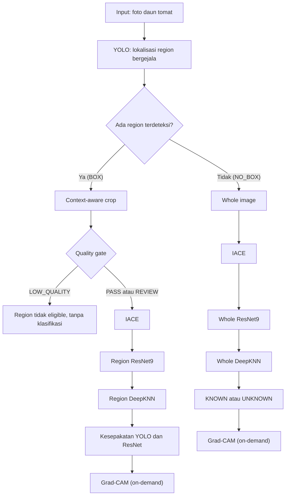

| Komponen | Fungsi |
|---|---|
| YOLO | Menentukan region bergejala beserta label dan confidence |
| IACE | Penyesuaian iluminasi dan kontras sebelum klasifikasi |
| Quality gate | Menentukan apakah region layak diklasifikasi (`PASS`/`REVIEW`/`LOW_QUALITY`) |
| Region ResNet9 | Klasifikasi penyakit per region |
| Whole ResNet9 | Klasifikasi seluruh gambar (mencakup kelas Healthy) |
| DeepKNN | Skor keandalan terhadap distribusi referensi (deteksi OOD) |
| Grad-CAM | Heatmap atensi model |
| RetinaNet | Detektor alternatif pembanding (opsional, bergantung pada checkpoint) |

Daftar kelas penyakit: *(isi dari `REGION_DISPLAY_CLASSES` dan `WHOLE_DISPLAY_CLASSES` pada `tomato_pipeline.py`)*.

### 5.2 Status Keluaran Pipeline

| Status | Arti |
|---|---|
| `SUPPORTED_AGREEMENT` | YOLO dan ResNet9 sepakat dengan dukungan keandalan memadai |
| `SUPPORTED_DISAGREEMENT` | YOLO dan ResNet9 memberi label berbeda |
| `LOW_REGION_SUPPORT_UNCERTAIN`, `UNCERTAIN_REVIEW` | Keyakinan rendah, perlu review |
| `MODEL_DISAGREEMENT_REVIEW` | Model tidak sepakat, perlu review |
| `KNOWN` | Gambar dikenali sistem (branch NO_BOX) |
| `UNKNOWN` | Gambar di luar jangkauan sistem |

### 5.3 Prinsip Integrasi

| Prinsip | Penjelasan |
|---|---|
| Pipeline dibekukan | Bobot, threshold, dan parameter (`yolo_conf`, `yolo_iou`, `yolo_imgsz`, `region_k`, `region_threshold`, `whole_k`, `whole_threshold`) tidak diubah |
| `tomato_pipeline.py` tidak diedit | Diperlakukan sebagai dependensi terkunci; SHA256 modul diverifikasi terhadap `runtime_manifest.json` |
| Adapter terpisah | Seluruh penyesuaian (serialisasi JSON/PNG, pemanggilan `explain_*`, `classify_without_iace`, `detect_with_retinanet`) berada di `adapter.py` |
| Tanpa resize gambar | Pembatasan input hanya berupa ukuran file; resize dapat mengubah hasil deteksi |
| Mode CPU-safe | Mengikuti prototipe, untuk menghindari CUDA OOM pada gambar dengan banyak region |

---

## 6. Arsitektur Sistem

### 6.1 Komponen

| Komponen | Tanggung jawab |
|---|---|
| `frontend` | Antarmuka petani dan admin, overlay bbox, slider opacity Grad-CAM, grafik |
| `core-service` (API) | Auth, lahan, diagnosis, aturan bisnis, riwayat, analitik, review, laporan |
| `core-service` (Worker) | Mengambil job dari antrean, memanggil inference-service, menerapkan aturan bisnis, menyimpan hasil |
| `inference-service` | Membungkus `tomato_pipeline.py` melalui `adapter.py`; hanya dapat diakses dari jaringan internal |
| Redis | Antrean job (BullMQ) |
| PostgreSQL | Data aplikasi dan hasil terstruktur |
| MinIO | Object storage untuk gambar asli, gambar IACE, dan heatmap |
| Nginx | Reverse proxy sebagai satu-satunya pintu masuk publik |

### 6.2 Diagram Arsitektur

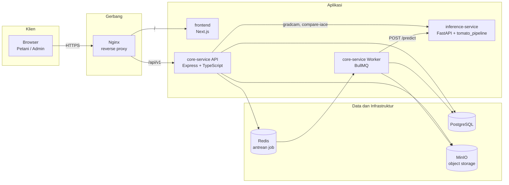

### 6.3 Diagram Deployment

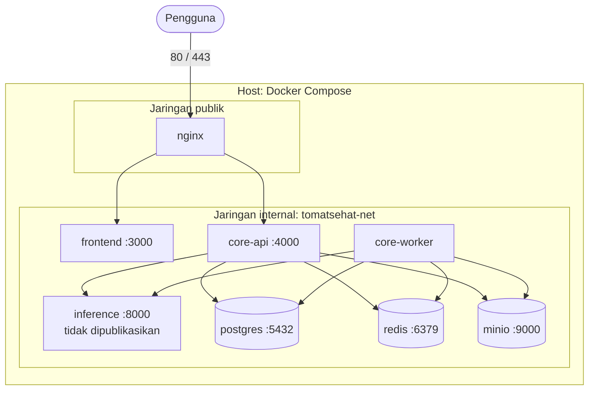

### 6.4 Alur Diagnosis

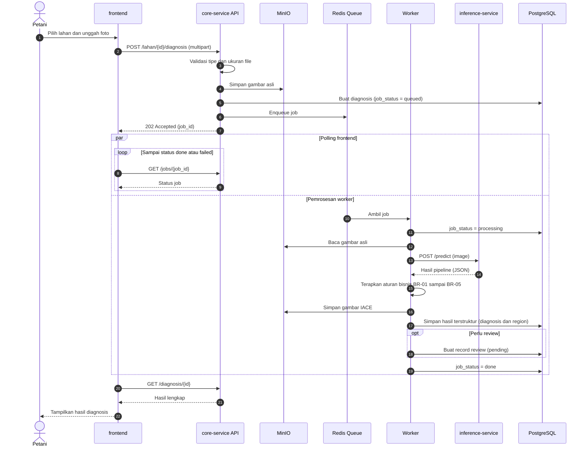

### 6.5 Alur On-Demand (Grad-CAM dan Perbandingan IACE)

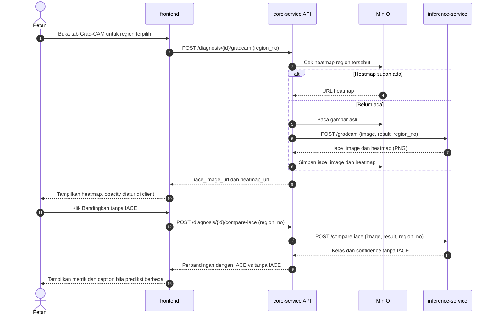

---

## 7. Tech Stack

Pilihan di bawah berstatus **usulan yang ditetapkan untuk PRD ini** dan dapat diubah sebelum M2. Periksa Panduan Proyek 3 bila ada ketentuan bahasa atau framework yang diwajibkan.

### 7.1 Ringkasan Stack

| Lapisan | Pilihan | Catatan |
|---|---|---|
| Frontend | Next.js 15 (App Router), TypeScript, Tailwind CSS, shadcn/ui | Overlay bbox memakai SVG; grafik memakai Recharts |
| Data fetching dan form (frontend) | TanStack Query, React Hook Form, Zod | Tipe API dibangkitkan dari OpenAPI dengan `openapi-typescript` |
| Core-service | Node.js 22 LTS, Express, TypeScript | API dan worker memakai basis kode yang sama, dijalankan sebagai dua proses |
| Validasi dan ORM (core) | Zod, Prisma (CRUD) dan raw SQL (view analitik) | Prisma tidak mengelola materialized view, sehingga view dibuat lewat file SQL migrasi |
| Autentikasi | JWT, hashing password argon2 atau bcrypt | Token berlaku default 24 jam (konfigurasi); refresh token di luar scope |
| Antrean job | Redis 7 dan BullMQ | |
| Database | PostgreSQL 16 | Mendukung `jsonb`, index, dan materialized view |
| Object storage | MinIO (kompatibel S3) | Akses lewat AWS SDK v3 |
| Inference-service | Python 3.11, FastAPI, Uvicorn | Satu worker Uvicorn; model dimuat sekali saat startup |
| ML runtime | PyTorch (CPU), ultralytics, scikit-learn, OpenCV headless, Pillow | Lihat 7.3 |
| Dokumentasi API | OpenAPI 3 dan Swagger UI | Core-service: kontrak ditulis di `openapi/openapi.yaml`; inference-service: otomatis dari FastAPI |
| Laporan PDF (P2) | PDFKit | Hanya bila XT-01 dan XT-02 dikerjakan |
| Reverse proxy | Nginx | Satu pintu masuk publik |
| Kontainerisasi | Docker dan Docker Compose | Satu perintah menjalankan seluruh layanan |
| Pengujian | Vitest dan Supertest (core), pytest (inference), Playwright (opsional, frontend) | Tes parity SM-02 berada di inference-service |
| Kualitas kode | ESLint dan Prettier (TS), Ruff (Python) | |

### 7.2 Alasan dan Alternatif

| Keputusan | Alasan | Alternatif |
|---|---|---|
| Express + TypeScript untuk core-service | Cepat dikerjakan untuk 36 fitur P0, satu bahasa dengan frontend, dan BullMQ matang di ekosistem Node | Go (Gin atau Fiber): lebih ringan, tetapi pustaka antrean dan ORM lebih sedikit |
| Python + FastAPI untuk inference-service | Pipeline berbasis PyTorch dan Python; tidak ada alasan membungkusnya dengan bahasa lain | Tidak ada, karena `tomato_pipeline.py` tidak boleh diubah |
| PostgreSQL di dalam Compose | Mendukung materialized view untuk analitik dan berjalan dengan satu perintah | Supabase sebagai Postgres terkelola; core-service tetap terhubung lewat koneksi Postgres biasa agar tidak terikat SDK |
| Redis + BullMQ | Antrean sederhana dengan retry dan status job bawaan | RabbitMQ: lebih berat untuk skala proyek ini |
| MinIO | Kompatibel S3, bisa dijalankan lokal, URL bertanda tangan tersedia | Volume Docker biasa, dengan konsekuensi tidak ada URL bertanda tangan |
| Nginx | Konfigurasi sederhana untuk routing `/` dan `/api/v1` | Traefik |

### 7.3 Dependensi Inference-Service

| Paket | Versi minimum (acuan notebook) |
|---|---|
| torch | 2.2 |
| torchvision | 0.17 |
| ultralytics | 8.3 |
| numpy | 1.26 |
| scikit-learn | 1.4 |
| opencv-python-headless | 4.9 |
| Pillow | 10.0 |
| pandas | 2.0 |
| fastapi, uvicorn, python-multipart, pydantic | Versi stabil terkini pada saat setup, dikunci di `requirements.txt` |

Streamlit dan pyngrok **tidak** dibawa ke inference-service.

Catatan: kunci versi paket ML sesuai yang dicatat notebook pada `check_dependencies` bila memungkinkan, karena model dan skor DeepKNN dilatih dan diverifikasi pada versi tersebut. Perbedaan versi `torch` atau `scikit-learn` dapat mengubah hasil numerik, sehingga tes parity (SM-02) wajib dijalankan setelah image dibangun.

### 7.4 Target Runtime

| Aspek | Ketentuan |
|---|---|
| Mode inferensi | CPU (mengikuti prototipe, untuk menghindari CUDA OOM pada gambar dengan banyak region) |
| Konkurensi inferensi | Satu inferensi pada satu waktu per instance (`MAX_CONCURRENCY=1`); permintaan lain menunggu di antrean |
| Kebutuhan memori dan waktu inferensi | Diukur pada M1, lalu dicatat di README inference-service |
| Target deployment | Docker Compose pada satu mesin; publikasi eksternal opsional (misalnya melalui tunnel), tanpa mengekspos inference-service |

---

## 8. Struktur Project dan Repository

### 8.1 Strategi Repository

Tiga repository sesuai konsep microservices proyek. Setiap repository memiliki Dockerfile sendiri dan dapat dibangun serta diuji secara independen.

| Repository | Peran | Bahasa |
|---|---|---|
| `tomatsehat-frontend` | Antarmuka petani dan admin | TypeScript |
| `tomatsehat-core-service` | API, worker, aturan bisnis, analitik, dan berkas orkestrasi Compose | TypeScript |
| `tomatsehat-inference-service` | Pembungkus pipeline ML | Python |

**Lokasi `docker-compose.yml`:** berada di `tomatsehat-core-service/deploy/` dan mereferensikan dua repository lain melalui `build.context` relatif. Ketiga repository di-clone berdampingan pada satu direktori induk. Bila aturan tiga repository tidak ketat, berkas orkestrasi dan dokumentasi gabungan sebaiknya dipindahkan ke repository ke-4 (`tomatsehat-deploy`).

Kontrak antar layanan:

| Kontrak | Lokasi | Dikonsumsi oleh |
|---|---|---|
| OpenAPI core-service | `tomatsehat-core-service/openapi/openapi.yaml` | frontend (pembangkitan tipe TypeScript) |
| OpenAPI inference-service | Otomatis dari FastAPI pada `/openapi.json` | core-service (klien inference) |

### 8.2 `tomatsehat-core-service`

```text
tomatsehat-core-service/
├── src/
│   ├── app.ts                    # Konfigurasi Express
│   ├── server.ts                 # Entry point API
│   ├── worker.ts                 # Entry point worker BullMQ
│   ├── config/                   # Env dan konstanta (parameter BR-03, BR-04)
│   ├── middleware/               # auth, rbac, upload, rate-limit, error-handler
│   ├── modules/
│   │   ├── auth/                 # route, controller, service, schema
│   │   ├── lahan/
│   │   ├── diagnosis/            # upload, job, hasil, on-demand
│   │   ├── analytics/
│   │   ├── review/
│   │   ├── admin/
│   │   ├── penyakit/
│   │   ├── model-info/
│   │   └── report/               # P2
│   ├── domain/                   # Aturan bisnis murni: BR-01 sampai BR-05
│   │   ├── diagnosis-aggregator.ts
│   │   ├── keandalan.ts
│   │   └── alert-rule.ts
│   ├── clients/
│   │   ├── inference.client.ts
│   │   └── storage.client.ts
│   ├── jobs/
│   │   ├── queue.ts
│   │   └── diagnosis.processor.ts
│   ├── db/                       # Prisma client dan repository
│   └── utils/
├── prisma/
│   ├── schema.prisma
│   ├── migrations/
│   ├── views/                    # SQL view dan materialized view analitik
│   └── seed.ts                   # Seed data demo (diberi penanda "data contoh")
├── openapi/
│   └── openapi.yaml
├── tests/
│   ├── unit/                     # Logika domain
│   └── integration/              # Endpoint API
├── deploy/
│   ├── docker-compose.yml
│   ├── nginx.conf
│   └── .env.example
├── Dockerfile
├── package.json
├── tsconfig.json
└── README.md
```

Folder `domain/` tidak boleh bergantung pada Express atau Prisma, sehingga aturan bisnis dapat diuji secara terisolasi.

### 8.3 `tomatsehat-inference-service`

```text
tomatsehat-inference-service/
├── app/
│   ├── main.py                   # FastAPI; lifespan memanggil initialize() sekali
│   ├── api/
│   │   ├── predict.py
│   │   ├── gradcam.py
│   │   ├── compare.py            # compare-iace dan compare-retinanet
│   │   ├── info.py
│   │   └── health.py
│   ├── adapter.py                # Satu-satunya pintu ke tomato_pipeline
│   ├── serializers.py            # numpy dan PIL ke JSON dan PNG
│   ├── schemas.py                # Model Pydantic
│   ├── security.py               # Verifikasi X-Internal-Token
│   └── config.py
├── vendor/
│   └── tomato_pipeline.py        # Tidak diedit; SHA256 diverifikasi saat startup
├── assets/                       # Bobot model, reference bank, model_metrics.json
├── runtime_manifest.json
├── tests/
│   ├── test_parity.py            # SM-02
│   ├── test_adapter.py
│   └── fixtures/images/
├── requirements.txt
├── Dockerfile
└── README.md
```

Berkas aset berukuran besar tidak di-commit ke Git biasa. Aset diunduh saat build image atau di-mount sebagai volume; gunakan Git LFS hanya bila terpaksa.

### 8.4 `tomatsehat-frontend`

```text
tomatsehat-frontend/
├── src/
│   ├── app/                      # Next.js App Router
│   │   ├── (auth)/
│   │   │   ├── login/
│   │   │   └── register/
│   │   ├── (petani)/
│   │   │   ├── lahan/
│   │   │   │   └── [id]/
│   │   │   │       └── upload/
│   │   │   ├── diagnosis/[id]/
│   │   │   ├── penyakit/
│   │   │   └── model/
│   │   ├── (admin)/admin/
│   │   │   ├── dashboard/
│   │   │   ├── users/
│   │   │   ├── lahan/
│   │   │   └── review/[id]/
│   │   └── layout.tsx
│   ├── components/
│   │   ├── ui/                   # shadcn/ui
│   │   ├── diagnosis/            # BBoxOverlay, RegionPanel, StatusBadge, CounterCards,
│   │   │                         # IaceToggle, GradcamViewer, CompareIace, Disclaimer
│   │   ├── charts/               # TrendChart, DonutChart, StackedBar
│   │   └── layout/
│   ├── hooks/                    # useJobPolling, dan lainnya
│   ├── lib/
│   │   ├── api-client.ts
│   │   ├── auth.ts
│   │   └── status.ts             # Peta kode status ke label, warna, dan penjelasan
│   ├── types/
│   │   └── api.d.ts              # Dibangkitkan dari OpenAPI
│   └── middleware.ts             # Penjaga rute berdasarkan role
├── public/
├── Dockerfile
├── package.json
└── README.md
```

### 8.5 Environment Variable

| Layanan | Variabel | Keterangan |
|---|---|---|
| core-service | `DATABASE_URL`, `REDIS_URL` | Koneksi database dan antrean |
| core-service | `JWT_SECRET`, `JWT_EXPIRES_IN` | Pengaturan token |
| core-service | `MINIO_ENDPOINT`, `MINIO_ACCESS_KEY`, `MINIO_SECRET_KEY`, `MINIO_BUCKET` | Object storage |
| core-service | `INFERENCE_URL`, `INFERENCE_TOKEN` | Alamat dan token internal inference-service |
| core-service | `MAX_UPLOAD_BYTES` | Batas ukuran file unggahan |
| core-service | `ALERT_MIN_CASES`, `ALERT_WINDOW_DAYS` | Parameter BR-04 (default 3 dan 14) |
| core-service | `KEANDALAN_CUTOFF_*` | Batas level keandalan (BR-03) |
| inference-service | `INTERNAL_TOKEN` | Token yang diverifikasi dari core-service |
| inference-service | `ASSETS_DIR`, `DEVICE`, `MAX_CONCURRENCY` | Lokasi aset, `cpu`, dan 1 |
| frontend | `NEXT_PUBLIC_API_BASE_URL` | Alamat API publik (`/api/v1`) |

Seluruh nilai rahasia hanya ada di `.env` lokal; repository hanya memuat `.env.example`.

### 8.6 Kerangka Docker Compose

```yaml
services:
  nginx:
    image: nginx:stable
    ports: ["80:80"]
    volumes: ["./nginx.conf:/etc/nginx/nginx.conf:ro"]
    depends_on: [frontend, core-api]

  frontend:
    build: { context: ../../tomatsehat-frontend }
    environment:
      NEXT_PUBLIC_API_BASE_URL: /api/v1

  core-api:
    build: { context: .. }
    command: node dist/server.js
    env_file: .env
    depends_on: [postgres, redis, minio]

  core-worker:
    build: { context: .. }
    command: node dist/worker.js
    env_file: .env
    depends_on: [postgres, redis, minio, inference]

  inference:
    build: { context: ../../tomatsehat-inference-service }
    environment:
      DEVICE: cpu
      MAX_CONCURRENCY: "1"
      INTERNAL_TOKEN: ${INFERENCE_TOKEN}
    volumes: ["inference-assets:/app/assets"]
    healthcheck:
      test: ["CMD", "curl", "-f", "http://localhost:8000/health"]

  postgres:
    image: postgres:16
    env_file: .env
    volumes: ["pg-data:/var/lib/postgresql/data"]

  redis:
    image: redis:7

  minio:
    image: minio/minio
    command: server /data --console-address ":9001"
    volumes: ["minio-data:/data"]

volumes:
  pg-data:
  minio-data:
  inference-assets:
```

Kerangka ini hanya acuan struktur; port, healthcheck, dan variabel lengkap difinalkan pada M2.

### 8.7 Konvensi Repository

| Aspek | Ketentuan |
|---|---|
| Branch | `main` (stabil), `dev` (integrasi), `feature/<id-fitur>` (contoh: `feature/dg-03-kartu-hasil`) |
| Commit | Conventional Commits (`feat`, `fix`, `docs`, `test`, `chore`) dengan ID fitur pada scope |
| Versi | Semantic Versioning per repository; `pipeline_version` dicatat terpisah pada tiap diagnosis |
| Pull request | Wajib lolos lint dan tes sebelum merge ke `dev` |
| Dokumentasi | Setiap repository memiliki README berisi cara menjalankan, variabel lingkungan, dan cara menjalankan tes |

---

## 9. Aturan Bisnis

| ID | Aturan |
|---|---|
| BR-01 | **Diagnosis akhir branch BOX:** kelas mayoritas dari region berstatus `SUPPORTED_AGREEMENT`. Jika tidak ada region demikian, hasilnya "Perlu review" dan masuk antrean review. |
| BR-02 | **Diagnosis akhir branch NO_BOX:** memakai hasil whole-image bila `KNOWN`. Label Healthy hanya muncul bila prediksi Healthy **dan** `KNOWN`. `UNKNOWN` masuk antrean review. |
| BR-03 | **Level keandalan** (rendah/sedang/tinggi) diturunkan dari skor DeepKNN relatif terhadap threshold. Batas tiap level ditetapkan tim dan didokumentasikan. Istilah yang dipakai adalah "keandalan", bukan "akurasi". |
| BR-04 | **Peringatan lahan:** dipicu bila terdapat minimal 3 diagnosis penyakit yang sama pada satu lahan dalam 14 hari. Kedua angka bersifat konfigurasi. |
| BR-05 | Hasil yang tidak dapat ditentukan (`UNKNOWN`, review) dikategorikan **"tidak dapat ditentukan"** dan tidak pernah dihitung sebagai sehat pada analitik. |
| BR-06 | Disclaimer wajib tampil: Grad-CAM menunjukkan atensi model dan bukan segmentasi lesi; `NO_BOX` bukan otomatis Healthy; keandalan bukan akurasi. |
| BR-07 | Label koreksi dari admin disimpan terpisah dan **tidak mengubah** hasil diagnosis sistem yang tersimpan. |
| BR-08 | Analitik diberi label yang jujur: distribusi penyakit adalah "berdasarkan foto yang diunggah" (bukan prevalensi lapangan); hasil review disebut "tingkat koreksi pada kasus yang direview" (bukan akurasi model). |
| BR-09 | Perbandingan RetinaNet bersifat informatif dan tidak pernah mengubah diagnosis akhir. |
| BR-10 | Hapus lahan menggunakan soft delete agar riwayat dan analitik tetap konsisten. |

---

## 10. Flowchart dan Diagram Alur

### 10.1 Alur Pengguna Petani

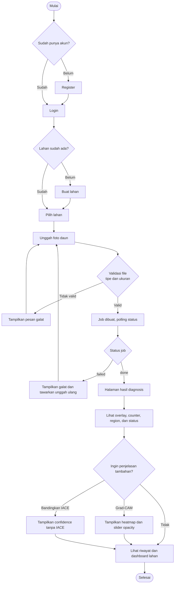

### 10.2 Alur Keputusan Diagnosis Akhir (BR-01, BR-02, BR-05)

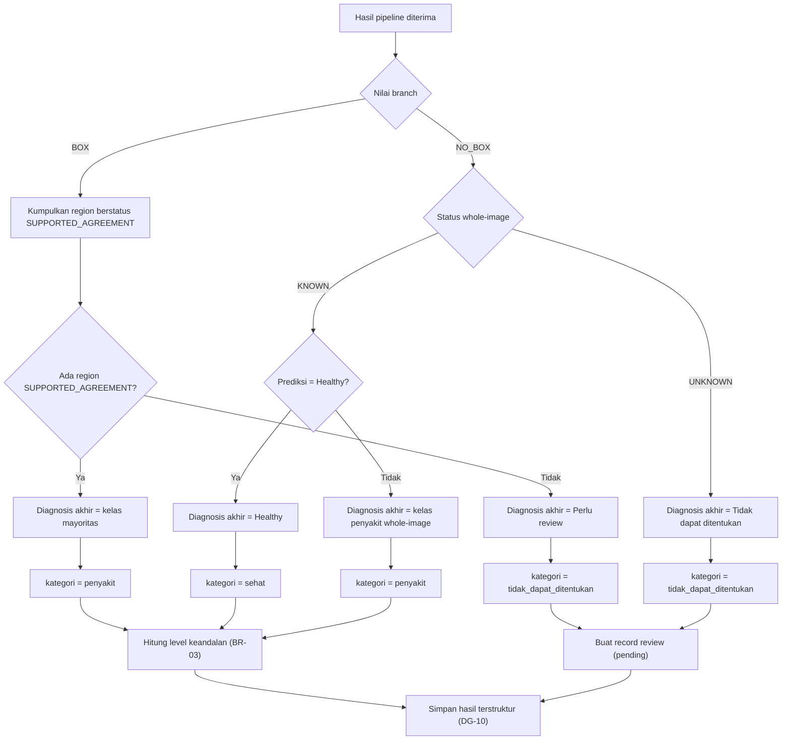

Catatan untuk ditetapkan pada M3 (usulan):
- Bila dua kelas memiliki jumlah region sama, pilih kelas dengan rata-rata `resnet_confidence` tertinggi.
- Kelas lain yang juga didukung tetap ditampilkan sebagai "temuan tambahan", tetapi tidak menjadi diagnosis akhir.
- Level keandalan branch BOX dihitung dari region yang mendasari diagnosis akhir (rata-rata atau nilai terburuk).

### 10.3 Alur Peringatan Lahan (BR-04)

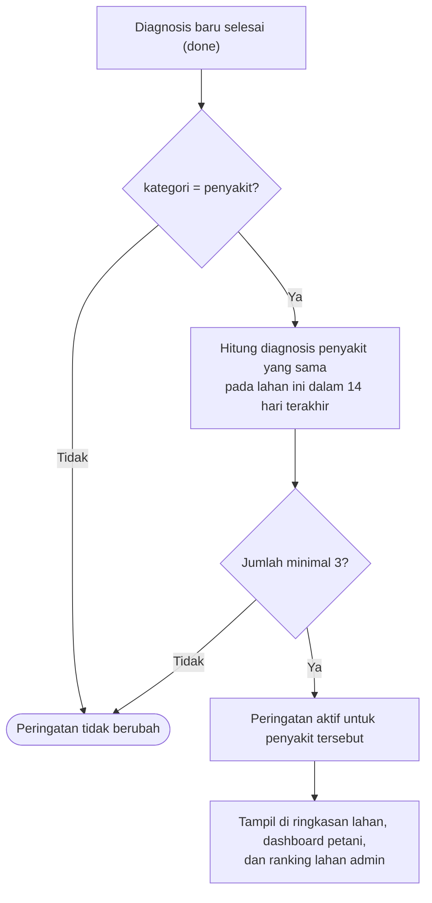

Status peringatan dihitung saat dibaca (melalui query atau view), bukan disimpan permanen, sehingga peringatan padam sendiri ketika jumlah kasus dalam jendela waktu turun di bawah ambang.

### 10.4 Alur Review Admin

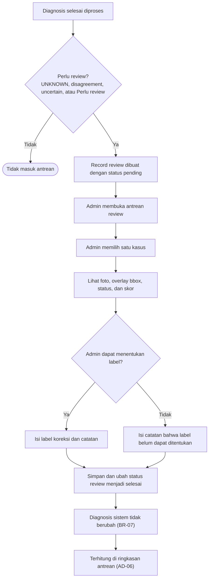

### 10.5 Diagram Status

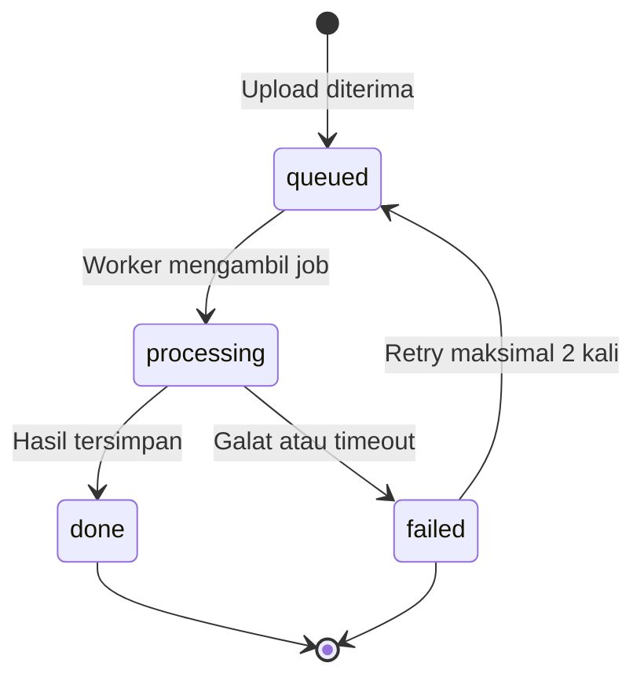

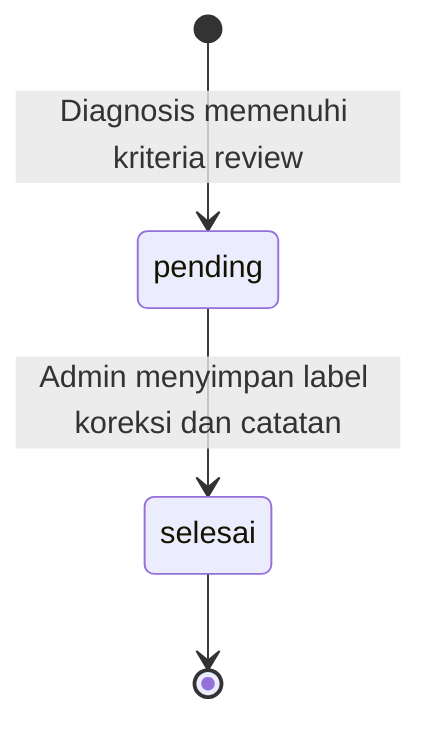

---

## 11. Kebutuhan Fungsional

Prioritas: **P0** wajib, **P1** sebaiknya ada, **P2** opsional.

### 11.1 Autentikasi dan Pengguna

| ID | Kebutuhan | Prio |
|---|---|---|
| AU-01 | Sistem memungkinkan register dan login; sistem menerbitkan JWT | P0 |
| AU-02 | Sistem menerapkan peran petani/admin; petani hanya dapat mengakses lahan dan diagnosis miliknya | P0 |
| AU-03 | Pengguna dapat melihat dan mengubah profil serta password | P1 |

### 11.2 Lahan

| ID | Kebutuhan | Prio |
|---|---|---|
| LH-01 | Petani dapat membuat, melihat, mengubah, dan menghapus lahan (nama, catatan) | P0 |
| LH-02 | Sistem menampilkan ringkasan lahan: jumlah foto, diagnosis terakhir beserta status, status peringatan | P0 |

### 11.3 Diagnosis

| ID | Kebutuhan | Prio |
|---|---|---|
| DG-01 | Petani mengunggah foto (jpg/jpeg/png) ke lahan terpilih; ukuran file dibatasi (nilai default dapat dikonfigurasi); gambar tidak di-resize | P0 |
| DG-02 | Pemrosesan asinkron: balasan `202` + `job_id`, status job `queued`/`processing`/`done`/`failed`, penanganan kegagalan | P0 |
| DG-03 | Kartu hasil menampilkan diagnosis akhir dan badge status sesuai BR-01 dan BR-02 | P0 |
| DG-04 | Menampilkan tiga counter: Detected, Eligible, Supported, lengkap dengan tooltip penjelasan | P0 |
| DG-05 | Overlay bounding box interaktif di sisi client; klik box memilih region | P0 |
| DG-06 | Detail region: label YOLO, label ResNet9, confidence, skor keandalan terhadap threshold | P0 |
| DG-07 | Toggle tampilan gambar asli dan gambar setelah IACE | P0 |
| DG-08 | Penanganan branch NO_BOX (whole-image) sesuai BR-02 | P0 |
| DG-09 | Umpan balik kualitas foto berdasarkan `quality.status` (contoh: "foto kurang tajam, coba ulang") | P1 |
| DG-10 | Persistensi terstruktur: `hasil_json` mentah, kolom ter-index, `pipeline_version`, `inference_seconds` | P0 |

### 11.4 Explainability dan Transparansi

| ID | Kebutuhan | Prio |
|---|---|---|
| EX-01 | Grad-CAM on-demand untuk region terpilih atau whole-image; slider opacity dihitung di client; hasil di-cache | P0 |
| EX-02 | Perbandingan confidence tanpa IACE untuk region dominan, on-demand dan tidak disimpan; caption muncul bila prediksi berbeda | P0 |
| EX-03 | Halaman "Tentang model": akurasi dari `model_metrics.json` (label sesuai isinya, validasi atau test), versi pipeline, daftar kelas, flag fitur opsional | P0 |
| EX-04 | Glosarium dan penjelasan arti setiap status | P1 |
| EX-05 | Disclaimer sesuai BR-06 tampil pada halaman hasil | P0 |

### 11.5 Monitoring Petani

| ID | Kebutuhan | Prio |
|---|---|---|
| MN-01 | Riwayat diagnosis per lahan dengan filter tanggal dan penyakit, serta pagination | P0 |
| MN-02 | Peringatan lahan sesuai BR-04 | P1 |

### 11.6 Dashboard Analitik Petani

| ID | Kebutuhan | Prio |
|---|---|---|
| AN-01 | Kartu ringkas: diagnosis terakhir, jumlah foto 30 hari, peringatan aktif | P0 |
| AN-02 | Tren penyakit per minggu | P0 |
| AN-03 | Proporsi sehat / bergejala / tidak dapat ditentukan | P0 |
| AN-04 | Tren keandalan (rata-rata skor DeepKNN per minggu; nilai null ditangani) | P1 |
| AN-05 | Perbandingan antar lahan milik petani | P1 |
| AN-06 | Timeline foto terbaru dengan badge status | P1 |
| AN-07 | Sebaran area bergejala (diberi label "sebaran", bukan keparahan) | P2 |

### 11.7 Dashboard Analitik Admin

| ID | Kebutuhan | Prio |
|---|---|---|
| AD-01 | KPI: total foto, petani aktif, jumlah lahan, persentase perlu review | P0 |
| AD-02 | Distribusi penyakit per periode | P0 |
| AD-03 | Tren diagnosis per minggu per penyakit | P0 |
| AD-04 | Ranking lahan berdasarkan kasus beserta peringatan aktif | P0 |
| AD-05 | Distribusi status dari waktu ke waktu | P0 |
| AD-06 | Ringkasan antrean review: jumlah pending, rata-rata waktu penyelesaian | P0 |

### 11.8 Manajemen Admin

| ID | Kebutuhan | Prio |
|---|---|---|
| AM-01 | Daftar petani dan lahan | P0 |
| AM-02 | Antrean review: menampilkan foto, overlay bbox, status, dan skor; admin mengisi label koreksi dan catatan; status `pending` menjadi `selesai` | P0 |
| AM-04 | Filter global (periode, lahan, penyakit) dan ekspor CSV analitik | P1 |

### 11.9 Fitur Tambahan

| ID | Kebutuhan | Prio |
|---|---|---|
| XT-01 | Laporan PDF per diagnosis (foto, overlay, Grad-CAM, status, skor) | P2 |
| XT-02 | Laporan PDF ringkasan lahan per periode | P2 |
| XT-03 | Perbandingan YOLO vs RetinaNet; hanya aktif bila checkpoint tersedia, sesuai BR-09 | P2 |
| XT-04 | Halaman informasi penyakit (konten statis) | P1 |

### 11.10 Platform

| ID | Komponen | Prio |
|---|---|---|
| PL-01 | Job queue dan worker | P0 |
| PL-02 | Object storage untuk gambar asli, IACE, dan heatmap | P0 |
| PL-03 | View atau materialized view agregasi serta index kolom analitik | P0 |
| PL-04 | Cache hasil analitik (TTL) dan cache berdasarkan hash gambar | P1 |
| PL-05 | Docker Compose untuk seluruh layanan | P0 |
| PL-06 | Dokumentasi OpenAPI/Swagger | P0 |
| PL-07 | Health check per layanan | P0 |
| PL-08 | Rate limit dan validasi input | P1 |
| PL-09 | Seed data demo yang diberi penanda jelas "data contoh" | P1 |
| PL-10 | `adapter.py` untuk inference-service tanpa mengedit `tomato_pipeline.py` | P0 |

### 11.11 Rekapitulasi

| Prioritas | Jumlah |
|---|---|
| P0 | 36 |
| P1 | 12 |
| P2 | 4 |
| **Total** | **52** |

---

## 12. Kebutuhan Non-Fungsional

| ID | Kategori | Kebutuhan |
|---|---|---|
| NFR-01 | Performa | Inferensi berjalan asinkron. Target waktu inferensi ditetapkan setelah benchmark di M1 (acuan: 0,4 hingga 1,1 detik per gambar pada GPU T4 di notebook; mode CPU diperkirakan lebih lambat). Endpoint non-inferensi (daftar, analitik) bertarget awal 1 detik pada data demo, dievaluasi di M5. |
| NFR-02 | Keamanan | Password di-hash (bcrypt atau argon2); JWT berkedaluwarsa; RBAC pada setiap endpoint; validasi tipe dan ukuran file; gambar diakses lewat URL terotorisasi, tidak publik |
| NFR-03 | Keandalan | Health check per layanan; timeout dan penanganan job gagal; retry terbatas |
| NFR-04 | Reprodusibilitas | `pipeline_version` disimpan pada setiap diagnosis; SHA256 `tomato_pipeline.py` diverifikasi saat startup; tes regresi parity (SM-02) |
| NFR-05 | Portabilitas | Seluruh layanan berjalan lewat Docker Compose; konfigurasi melalui environment variable |
| NFR-06 | Dokumentasi | OpenAPI untuk setiap layanan; README per repositori |
| NFR-07 | Privasi | Foto dan data lahan hanya dapat diakses pemiliknya dan admin |
| NFR-08 | Antarmuka | Responsif dan dapat dipakai di perangkat seluler (pengguna lapangan); mendukung browser modern |
| NFR-09 | Maintainability | Pemisahan lapisan (route, service, repository) dan pengujian minimal pada logika agregasi |

---

## 13. Spesifikasi Dashboard Analitik

### 13.1 Dashboard Petani (per lahan)

| ID | Widget | Visual | Sumber data |
|---|---|---|---|
| AN-01 | Kartu ringkas | Kartu | `diagnosis` |
| AN-02 | Tren penyakit | Line / stacked bar | `diagnosis_akhir`, `created_at` |
| AN-03 | Proporsi sehat / bergejala / tidak dapat ditentukan | Donut | `kategori` |
| AN-04 | Tren keandalan | Line dengan garis threshold | `deepknn_score` |
| AN-05 | Perbandingan antar lahan | Bar | `lahan_id` |
| AN-06 | Timeline foto | Daftar | `diagnosis` |
| AN-07 | Sebaran area bergejala | Line | `bbox_xyxy`, `image_size` |

Filter: rentang tanggal dan lahan.

### 13.2 Dashboard Admin

| ID | Widget | Visual | Sumber data |
|---|---|---|---|
| AD-01 | KPI | Kartu | seluruh tabel |
| AD-02 | Distribusi penyakit | Bar / donut | `diagnosis_akhir` |
| AD-03 | Tren diagnosis | Stacked bar | `created_at` |
| AD-04 | Ranking lahan dan peringatan aktif | Tabel | `lahan_id`, aturan BR-04 |
| AD-05 | Distribusi status | Stacked bar | `status_ringkas` |
| AD-06 | Ringkasan antrean review | Kartu + tabel | `review` |

Filter global: rentang tanggal, lahan, penyakit.

### 13.3 Ketentuan Analitik yang Jujur

| Risiko interpretasi | Ketentuan |
|---|---|
| Distribusi penyakit bukan prevalensi lapangan (orang cenderung memotret daun yang tampak sakit; satu tanaman dapat difoto berulang) | Berikan label "berdasarkan foto yang diunggah" |
| Healthy hanya berasal dari `NO_BOX` + `KNOWN` | Tampilkan kategori "tidak dapat ditentukan" terpisah (BR-05) |
| Hasil review berasal dari kasus sulit sehingga sampelnya bias | Gunakan istilah "tingkat koreksi pada kasus yang direview", bukan "akurasi" |
| Data sedikit membuat tren tidak bermakna | Seed data demo diberi penanda "data contoh" (PL-09) |
| Skor DeepKNN bernilai null untuk region tidak eligible | Agregasi mengabaikan null dan tidak menganggapnya nol |

---

## 14. Model Data

### 14.1 Tabel

| Tabel | Kolom utama |
|---|---|
| `users` | id, nama, email, password_hash, role, created_at |
| `lahan` | id, user_id, nama, catatan, deleted_at, created_at |
| `diagnosis` | id, lahan_id, user_id, image_path, iace_image_path, job_status, branch, diagnosis_akhir, kategori, status_ringkas, keandalan, num_yolo_regions, num_eligible, num_supported, quality_status, pipeline_version, inference_seconds, hasil_json, created_at |
| `diagnosis_region` | id, diagnosis_id, region_no, bbox_xyxy, yolo_class, yolo_confidence, resnet_class, resnet_confidence, status, ood_status, deepknn_score, deepknn_threshold, eligible, quality_status |
| `review` | id, diagnosis_id, status (`pending`/`selesai`), label_koreksi, catatan, reviewer_id, created_at, reviewed_at |
| `penyakit` | kode, nama, deskripsi, saran_umum |

`kategori` bernilai `penyakit`, `sehat`, atau `tidak_dapat_ditentukan`.

### 14.2 Index

| Tabel | Index |
|---|---|
| `diagnosis` | (`lahan_id`, `created_at`), `kategori`, `status_ringkas` |
| `diagnosis_region` | `diagnosis_id`, `status` |
| `review` | `status` |

Kolom yang dipakai analitik harus berupa kolom terstruktur, bukan hanya berada di dalam `hasil_json`. Perbandingan tanpa IACE (EX-02) tidak disimpan.

### 14.3 Diagram ERD

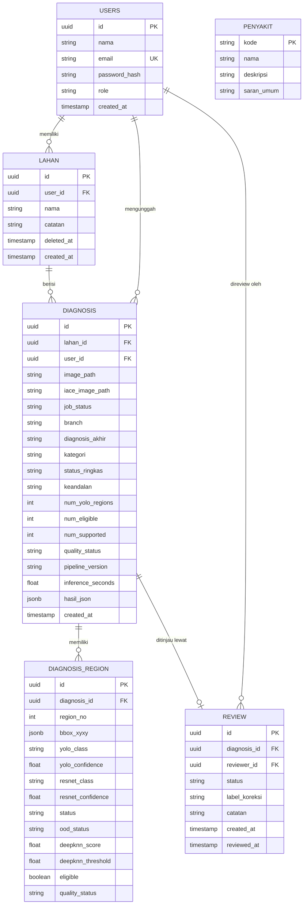

---

## 15. Desain dan Format API

### 15.1 Konvensi Umum

| Aspek | Ketentuan |
|---|---|
| Base URL | `/api/v1` (core-service); inference-service hanya internal tanpa prefiks |
| Format data | JSON UTF-8; unggah file memakai `multipart/form-data` |
| Autentikasi | Header `Authorization: Bearer <JWT>`; endpoint publik: register, login, health |
| Penamaan field | `snake_case` pada JSON dan query parameter (selaras dengan keluaran pipeline) |
| Identitas | UUID untuk seluruh resource, kecuali `penyakit.kode` |
| Waktu | ISO 8601 dalam UTC (contoh: `2026-10-18T09:30:12Z`) |
| Paginasi | `page` (mulai 1), `per_page` (default 20, maksimum 100) |
| Pengurutan | `sort=created_at` atau `sort=-created_at` untuk menurun |
| Filter umum | `from`, `to` (tanggal `YYYY-MM-DD`), `lahan_id`, `penyakit`, `kategori`, `status` |
| Trace | Setiap respons memuat header `X-Request-Id` yang juga muncul di body galat |

### 15.2 Format Respons Sukses

Objek tunggal:

```json
{
  "data": { "id": "7a9e0c1b-3d42-4f58-8a6b-5c2e1d0f9a34", "nama": "Kebun Utara" }
}
```

Daftar dengan paginasi:

```json
{
  "data": [ { "id": "..." } ],
  "meta": { "page": 1, "per_page": 20, "total": 57, "total_pages": 3 }
}
```

### 15.3 Format Galat

```json
{
  "error": {
    "code": "VALIDATION_ERROR",
    "message": "Data yang dikirim tidak valid.",
    "details": [
      { "field": "nama", "issue": "wajib diisi" }
    ],
    "request_id": "req_01HZX..."
  }
}
```

| HTTP | `code` | Kapan dipakai |
|---|---|---|
| 400 | `VALIDATION_ERROR` | Body atau parameter tidak valid |
| 401 | `UNAUTHORIZED` | Token tidak ada, tidak valid, atau kedaluwarsa |
| 403 | `FORBIDDEN` | Role tidak berhak mengakses endpoint |
| 404 | `NOT_FOUND` | Resource tidak ada, **atau milik pengguna lain** (agar keberadaannya tidak bocor) |
| 409 | `CONFLICT` | Konflik data, misalnya email sudah terdaftar |
| 413 | `FILE_TOO_LARGE` | Ukuran file melebihi `MAX_UPLOAD_BYTES` |
| 415 | `UNSUPPORTED_MEDIA_TYPE` | Tipe file bukan jpg, jpeg, atau png |
| 422 | `UNPROCESSABLE_IMAGE` | File tidak dapat dibaca sebagai gambar |
| 429 | `RATE_LIMITED` | Melebihi batas permintaan |
| 500 | `INTERNAL_ERROR` | Galat tak terduga |
| 502 | `INFERENCE_UNAVAILABLE` | Inference-service tidak dapat dihubungi |
| 504 | `INFERENCE_TIMEOUT` | Inferensi melebihi batas waktu |

### 15.4 Pola Asinkron

| Langkah | Detail |
|---|---|
| Permintaan | `POST /lahan/{id}/diagnosis` mengembalikan `202 Accepted`, header `Location: /api/v1/jobs/{job_id}`, dan body berisi `job_id`, `diagnosis_id`, `status` |
| Polling | Frontend memanggil `GET /jobs/{job_id}` setiap 1 hingga 2 detik |
| Status | `queued`, `processing`, `done`, `failed` |
| Selesai | Saat `done`, body memuat `diagnosis_id`; hasil lengkap diambil lewat `GET /diagnosis/{id}` |
| Gagal | Saat `failed`, body memuat `error.code` dan `error.message` ringkas |

### 15.5 Daftar Endpoint core-service

Role: **P** petani, **A** admin, **\*** semua pengguna login, **-** publik.

| Method | Path | Role | Fitur |
|---|---|---|---|
| POST | `/auth/register` | - | AU-01 |
| POST | `/auth/login` | - | AU-01 |
| GET | `/me` | \* | AU-03 |
| PUT | `/me` | \* | AU-03 |
| PUT | `/me/password` | \* | AU-03 |
| GET | `/lahan` | P | LH-01 |
| POST | `/lahan` | P | LH-01 |
| GET | `/lahan/{id}` | P (pemilik), A | LH-01 |
| PUT | `/lahan/{id}` | P (pemilik) | LH-01 |
| DELETE | `/lahan/{id}` | P (pemilik), soft delete | LH-01, BR-10 |
| GET | `/lahan/{id}/ringkasan` | P (pemilik), A | LH-02 |
| POST | `/lahan/{id}/diagnosis` | P (pemilik) | DG-01, DG-02 |
| GET | `/jobs/{job_id}` | P (pemilik) | DG-02 |
| GET | `/lahan/{id}/diagnosis` | P (pemilik), A | MN-01 |
| GET | `/diagnosis/{id}` | P (pemilik), A | DG-03 sampai DG-09 |
| POST | `/diagnosis/{id}/gradcam` | P (pemilik), A | EX-01 |
| POST | `/diagnosis/{id}/compare-iace` | P (pemilik), A | EX-02 |
| POST | `/diagnosis/{id}/compare-retinanet` | P (pemilik), A | XT-03 (P2) |
| GET | `/diagnosis/{id}/report.pdf` | P (pemilik), A | XT-01 (P2) |
| GET | `/lahan/{id}/report.pdf` | P (pemilik), A | XT-02 (P2) |
| GET | `/lahan/{id}/analytics` | P (pemilik), A | AN-01 sampai AN-04, AN-06, AN-07 |
| GET | `/me/analytics/perbandingan-lahan` | P | AN-05 |
| GET | `/admin/analytics/overview` | A | AD-01 sampai AD-03 |
| GET | `/admin/analytics/status` | A | AD-05 |
| GET | `/admin/analytics/ranking-lahan` | A | AD-04 |
| GET | `/admin/export/analytics.csv` | A | AM-04 |
| GET | `/admin/users` | A | AM-01 |
| GET | `/admin/lahan` | A | AM-01 |
| GET | `/admin/review` | A | AM-02 |
| GET | `/admin/review/summary` | A | AD-06 |
| GET | `/admin/review/{id}` | A | AM-02 |
| PUT | `/admin/review/{id}` | A | AM-02 |
| GET | `/model/info` | \* | EX-03 |
| GET | `/penyakit` | \* | XT-04 |
| GET | `/penyakit/{kode}` | \* | XT-04 |
| GET | `/glosarium` | \* | EX-04 |
| GET | `/health` | - | PL-07 |

### 15.6 Contoh Request dan Response

Seluruh nama kelas, angka, dan ID pada contoh hanyalah ilustrasi.

**Login**

```http
POST /api/v1/auth/login
Content-Type: application/json

{ "email": "petani@example.com", "password": "********" }
```

```json
{
  "data": {
    "access_token": "<jwt>",
    "token_type": "Bearer",
    "expires_in": 86400,
    "user": { "id": "5d2c...", "nama": "Pak Budi", "role": "petani" }
  }
}
```

**Unggah foto**

```http
POST /api/v1/lahan/7a9e0c1b-3d42-4f58-8a6b-5c2e1d0f9a34/diagnosis
Authorization: Bearer <jwt>
Content-Type: multipart/form-data

image=@daun_001.jpg
```

```http
HTTP/1.1 202 Accepted
Location: /api/v1/jobs/9c1f6a52-7e0b-4b8e-a1d3-0f4e2b7c8d11
```

```json
{
  "data": {
    "job_id": "9c1f6a52-7e0b-4b8e-a1d3-0f4e2b7c8d11",
    "diagnosis_id": "b3f1c2d4-0a5e-4c7b-9e11-2f6a8d9c1e50",
    "status": "queued"
  }
}
```

**Status job**

```json
{
  "data": {
    "job_id": "9c1f6a52-7e0b-4b8e-a1d3-0f4e2b7c8d11",
    "status": "done",
    "diagnosis_id": "b3f1c2d4-0a5e-4c7b-9e11-2f6a8d9c1e50"
  }
}
```

**Detail diagnosis (branch BOX)**

`region_no` bernilai `region_id` pipeline ditambah satu, mengikuti penomoran di Streamlit.

```json
{
  "data": {
    "id": "b3f1c2d4-0a5e-4c7b-9e11-2f6a8d9c1e50",
    "lahan_id": "7a9e0c1b-3d42-4f58-8a6b-5c2e1d0f9a34",
    "job_status": "done",
    "branch": "BOX",
    "diagnosis_akhir": "Penyakit A",
    "kategori": "penyakit",
    "status_ringkas": "SUPPORTED_AGREEMENT",
    "keandalan": { "level": "tinggi" },
    "counters": { "detected": 3, "eligible": 2, "supported": 2 },
    "quality_status": "PASS",
    "images": {
      "original_url": "https://.../original.jpg",
      "iace_url": "https://.../iace.png",
      "width": 1280,
      "height": 960
    },
    "regions": [
      {
        "region_no": 1,
        "bbox_xyxy": [120, 80, 340, 300],
        "yolo_class": "Penyakit A",
        "yolo_confidence": 0.91,
        "eligible": true,
        "quality_status": "PASS",
        "resnet_class": "Penyakit A",
        "resnet_confidence": 0.97,
        "status": "SUPPORTED_AGREEMENT",
        "ood_status": "KNOWN",
        "deepknn_score": 0.42,
        "deepknn_threshold": 0.80
      },
      {
        "region_no": 2,
        "bbox_xyxy": [500, 210, 690, 410],
        "yolo_class": "Penyakit A",
        "yolo_confidence": 0.84,
        "eligible": true,
        "quality_status": "REVIEW",
        "resnet_class": "Penyakit A",
        "resnet_confidence": 0.93,
        "status": "SUPPORTED_AGREEMENT",
        "ood_status": "KNOWN",
        "deepknn_score": 0.55,
        "deepknn_threshold": 0.80
      }
    ],
    "review": null,
    "pipeline_version": "final",
    "inference_seconds": 0.84,
    "created_at": "2026-10-18T09:30:12Z"
  }
}
```

Untuk branch `NO_BOX`, `regions` bernilai `[]` dan objek `whole_image` disertakan:

```json
{
  "branch": "NO_BOX",
  "regions": [],
  "whole_image": {
    "candidate_diagnosis": "Healthy",
    "confidence": 0.96,
    "status": "KNOWN",
    "deepknn_score": 0.31,
    "deepknn_threshold": 0.70
  }
}
```

Nama field `confidence` pada `whole_image` mengikuti hasil verifikasi M1 (lihat Bagian 16).

**Grad-CAM**

```http
POST /api/v1/diagnosis/b3f1c2d4-0a5e-4c7b-9e11-2f6a8d9c1e50/gradcam
Content-Type: application/json

{ "region_no": 1 }
```

```json
{
  "data": {
    "region_no": 1,
    "target_class": "Penyakit A",
    "confidence": 0.97,
    "iace_image_url": "https://.../region1_iace.png",
    "heatmap_url": "https://.../region1_heatmap.png"
  }
}
```

`heatmap_url` berupa PNG heatmap berwarna tanpa blending, dibuat adapter dari array `cam`. Frontend menumpuknya di atas `iace_image_url` dan mengatur opacity-nya di sisi client.

**Perbandingan tanpa IACE**

```json
{
  "data": {
    "region_no": 1,
    "dengan_iace": { "class_name": "Penyakit A", "confidence": 0.97 },
    "tanpa_iace": { "class_name": "Penyakit B", "confidence": 0.71 },
    "prediksi_berbeda": true
  }
}
```

**Analitik petani**

```http
GET /api/v1/lahan/7a9e0c1b-3d42-4f58-8a6b-5c2e1d0f9a34/analytics?from=2026-09-18&to=2026-10-18
```

```json
{
  "data": {
    "periode": { "from": "2026-09-18", "to": "2026-10-18" },
    "ringkas": {
      "diagnosis_terakhir": { "diagnosis_akhir": "Penyakit A", "status_ringkas": "SUPPORTED_AGREEMENT", "tanggal": "2026-10-18" },
      "jumlah_foto": 15,
      "peringatan_aktif": [ { "penyakit": "Penyakit A", "jumlah": 3, "jendela_hari": 14 } ]
    },
    "tren_penyakit": [
      { "minggu": "2026-W38", "penyakit": "Penyakit A", "jumlah": 2 },
      { "minggu": "2026-W39", "penyakit": "Penyakit A", "jumlah": 3 }
    ],
    "proporsi": { "sehat": 4, "penyakit": 9, "tidak_dapat_ditentukan": 2 },
    "tren_keandalan": [
      { "minggu": "2026-W38", "rata_skor": 0.45, "n": 5 }
    ]
  }
}
```

**Simpan review (admin)**

```http
PUT /api/v1/admin/review/e8a4...
Content-Type: application/json

{ "label_koreksi": "Penyakit B", "catatan": "Gejala lebih sesuai dengan penyakit B." }
```

```json
{
  "data": {
    "id": "e8a4...",
    "diagnosis_id": "b3f1c2d4-0a5e-4c7b-9e11-2f6a8d9c1e50",
    "status": "selesai",
    "label_koreksi": "Penyakit B",
    "catatan": "Gejala lebih sesuai dengan penyakit B.",
    "reviewed_at": "2026-10-19T02:14:40Z"
  }
}
```

**Contoh galat: file terlalu besar**

```json
{
  "error": {
    "code": "FILE_TOO_LARGE",
    "message": "Ukuran file melebihi batas yang diizinkan.",
    "details": [ { "field": "image", "issue": "maksimum sesuai MAX_UPLOAD_BYTES" } ],
    "request_id": "req_01HZX..."
  }
}
```

### 15.7 Format API inference-service (Internal)

Inference-service tidak memakai envelope `data` agar keluaran pipeline tetap utuh. Seluruh endpoint (kecuali `/health`) mewajibkan header `X-Internal-Token`. Format galat sama dengan core-service.

| Endpoint | Input | Output |
|---|---|---|
| `POST /predict` | `multipart`: `image` | `{ "result": <keluaran pipeline>, "adapter_version": "..." }` |
| `POST /gradcam` | `multipart`: `image`, `result` (JSON string hasil pipeline tersimpan), `region_no` (hanya branch BOX) | `{ "target_class", "confidence", "iace_image_png_b64", "heatmap_png_b64" }` |
| `POST /compare-iace` | `multipart`: `image`, `result`, `region_no` (hanya branch BOX) | `{ "dengan_iace": {...}, "tanpa_iace": {...} }` |
| `POST /compare-retinanet` | `multipart`: `image` | `{ "yolo": [...], "retinanet": [...] }`; `404` bila checkpoint tidak tersedia |
| `GET /model/info` | - | `{ "pipeline_version", "classes", "metrics", "features": { "retinanet": true/false } }` |
| `GET /health` | - | `{ "status": "ok", "model_loaded": true }` |

Contoh respons `POST /predict` (dipersingkat):

```jsonc
{
  "result": {
    "pipeline_version": "final",
    "device": "cpu",
    "image_size": [1280, 960],
    "branch": "BOX",
    "num_yolo_regions": 3,
    "num_eligible_regions": 2,
    "num_sufficient_support": 2,
    "status_counts": { "SUPPORTED_AGREEMENT": 2 },
    "regions": [ /* ... lihat Bagian 16 */ ],
    "inference_seconds": 0.84
  },
  "adapter_version": "1.0.0"
}
```

---

## 16. Kontrak Inference-Service (Field Kunci)

Field berikut sudah dikeluarkan oleh `predict_tomato_image()`; adapter hanya menserialisasikannya.

| Level | Field |
|---|---|
| Top | `pipeline_version`, `device`, `image_size`, `branch`, `inference_seconds` |
| BOX | `num_yolo_regions`, `num_eligible_regions`, `num_sufficient_support`, `status_counts`, `supported_diagnoses`, `regions[]` |
| Region | `region_id`, `bbox_xyxy`, `yolo_class`, `yolo_confidence`, `quality.status`, `eligible`, `resnet_class`, `resnet_class_id`, `resnet_confidence`, `deepknn_score`, `deepknn_threshold`, `sufficient_region_support`, `agreement`, `status`, `final_diagnosis`, `decision` |
| NO_BOX | `whole_image` berisi `candidate_diagnosis`, `predicted_class_id`, `resnet_confidence`, `deepknn_score`, `deepknn_threshold`, `status`, `final_diagnosis`, `decision` |
| Grad-CAM | `target_class`, `confidence`, `iace_image`, `cam`, `overlay` (dikirim sebagai PNG; heatmap dan gambar dasar dipisah agar opacity diatur di client) |
| Perbandingan IACE | `class_name`, `confidence` |

**Catatan untuk diverifikasi:** `print_pipeline_result()` membaca `whole_image["resnet_confidence"]`, sedangkan `app.py` Streamlit membaca `whole.get("confidence")` pada branch NO_BOX. Nama field sebenarnya harus dipastikan sebelum kontrak JSON dibekukan.

---

## 17. Halaman Antarmuka

| Peran | Halaman |
|---|---|
| Umum | Login, register |
| Petani | Daftar lahan; detail lahan (riwayat, tren, peringatan, dashboard analitik); unggah foto; detail hasil (overlay bbox, counter, region, Grad-CAM, perbandingan IACE, disclaimer); informasi penyakit; tentang model; profil |
| Admin | Dashboard analitik; daftar petani dan lahan; antrean review dan detail review; ekspor data; tentang model |

---

## 18. Kriteria Penerimaan (Fitur P0 Utama)

| Fitur | Kriteria |
|---|---|
| DG-01, DG-02 | **Diberikan** petani login dan memiliki lahan, **ketika** mengunggah foto jpg yang valid, **maka** sistem membalas `202` dengan `job_id` dan status berubah menjadi `done` tanpa menggantung request HTTP |
| DG-01 | **Diberikan** file melebihi batas ukuran atau bukan jpg/jpeg/png, **maka** sistem menolak dengan pesan galat yang jelas |
| DG-03, BR-02 | **Diberikan** hasil `NO_BOX` berstatus `UNKNOWN`, **maka** diagnosis tidak pernah tampil sebagai Healthy dan record review dibuat |
| DG-04 sampai DG-06 | **Diberikan** hasil branch BOX, **maka** tiga counter, label YOLO dan ResNet9, confidence, serta skor terhadap threshold tampil sesuai nilai dari inference-service |
| DG-05 | **Ketika** pengguna mengklik sebuah box, **maka** detail region yang sesuai tampil |
| EX-01 | **Ketika** pengguna menggeser slider opacity, **maka** tampilan berubah tanpa permintaan ulang ke server |
| EX-02 | **Diberikan** prediksi tanpa IACE berbeda dari prediksi resmi, **maka** caption pembanding tampil |
| MN-01 | **Diberikan** petani memiliki riwayat, **maka** filter tanggal dan penyakit menghasilkan daftar yang sesuai |
| AU-02 | **Diberikan** petani A, **ketika** mengakses lahan petani B, **maka** sistem menolak (403/404) |
| AM-02 | **Ketika** admin menyimpan label koreksi, **maka** status review menjadi `selesai` dan diagnosis asli tidak berubah (BR-07) |
| AD-01 sampai AD-06 | **Diberikan** data pada rentang tanggal terpilih, **maka** angka pada dashboard sama dengan hasil query langsung pada tabel |
| SM-02 | Tes parity lolos untuk seluruh gambar uji |
| PL-05 | Satu perintah Docker Compose menjalankan seluruh layanan dan seluruh health check hijau |

---

## 19. Risiko dan Mitigasi

| Risiko | Dampak | Mitigasi |
|---|---|---|
| Inference-service berat (torch, ultralytics, scikit-learn) dan rawan OOM pada gambar dengan banyak region | Job gagal atau lambat | Load model sekali saat startup; mode CPU-safe; antrean job; timeout |
| Hasil per region sering ambigu (pada gambar uji di notebook, 15 dari 41 region berstatus `SUPPORTED_AGREEMENT`) | Hasil mentah membingungkan pengguna | Agregasi per foto sesuai BR-01; tampilkan status secara jujur |
| Nama field confidence NO_BOX tidak konsisten antara kode | Nilai kosong di UI | Verifikasi di M1 sebelum kontrak dibekukan |
| Checkpoint RetinaNet mungkin tidak tersedia | Fitur XT-03 gagal | Feature flag melalui `GET /model/info`; fitur P2 |
| Label akurasi (`val_accuracy` ditampilkan sebagai "test") menyesatkan | Klaim keliru | Samakan label dengan isi `model_metrics.json` |
| Bias seleksi pada analitik | Kesimpulan keliru | Ketentuan Bagian 13.3 |
| Scope terlalu besar untuk satu semester | Aplikasi tidak selesai | Prioritaskan M1 sampai M5 (seluruh P0); M6 dan M7 sebagai bonus |
| Resize atau pembatasan region di pipeline mengubah hasil | Hasil berbeda dari prototipe | Hanya batasi ukuran file; jangan ubah preprocessing |
| Streamlit + ngrok bukan target deployment | Prototipe tidak dapat dipakai langsung | Frontend dan API dibangun ulang; `app.py` hanya acuan alur UI |

---

## 20. Milestone

| Milestone | Isi | Fitur |
|---|---|---|
| M1 | Inference-service berjalan dan teruji | PL-10, PL-01, PL-07, endpoint `/predict`, benchmark, verifikasi nama field, setup tiga repository dan lint/CI dasar |
| M2 | Core-service dasar | AU-01, AU-02, LH-01, DG-01, DG-02, DG-10, PL-02, PL-05, PL-06 |
| M3 | Hasil diagnosis lengkap (parity Streamlit) | DG-03 sampai DG-08, EX-01, EX-02, EX-03, EX-05 |
| M4 | Monitoring dan dashboard petani | PL-03, LH-02, MN-01, AN-01 sampai AN-03 |
| M5 | Admin dan dashboard admin | AM-01, AM-02, AD-01 sampai AD-06 |
| M6 (P1) | Nilai tambah | AN-04 sampai AN-06, MN-02, AM-04, DG-09, EX-04, XT-04, AU-03, PL-04, PL-08, PL-09 |
| M7 (P2) | Opsional | AN-07, XT-01, XT-02, XT-03 |

OpenAPI (PL-06) dikerjakan paralel sejak M2. Cakupan minimum penilaian adalah M1 sampai M5.

---

## 21. Asumsi dan Keputusan Terbuka

| No | Hal | Status / usulan |
|---|---|---|
| 1 | Stack teknologi seluruh layanan | Ditetapkan pada Bagian 7; dapat diubah sebelum M2 bila Panduan Proyek 3 mewajibkan stack tertentu |
| 2 | Nama aplikasi | TomatSehat (usulan; dapat diganti sebelum M2 karena memengaruhi nama repository dan image) |
| 3 | Lokasi berkas `docker-compose.yml` | Usulan: `tomatsehat-core-service/deploy/` (Bagian 8.1) |
| 4 | Daftar kelas penyakit dan nama tampilannya | Diisi dari `REGION_DISPLAY_CLASSES` dan `WHOLE_DISPLAY_CLASSES` |
| 5 | Nama field confidence pada branch NO_BOX | Perlu diverifikasi (Bagian 16) |
| 6 | Isi `model_metrics.json` (validasi atau test) | Perlu diverifikasi |
| 7 | Ketersediaan checkpoint RetinaNet | Perlu dicek; bila tidak ada, XT-03 dikeluarkan |
| 8 | Batas ukuran file unggahan | Nilai default ditetapkan di M2 |
| 9 | Batas level keandalan (BR-03) | Ditetapkan setelah melihat sebaran skor DeepKNN pada data uji |
| 10 | Aturan seri dan agregasi keandalan untuk branch BOX | Usulan pada Bagian 10.2; ditetapkan di M3 |
| 11 | Admin membuka halaman hasil diagnosis petani (hanya baca) | Diasumsikan ya |

---

## Lampiran A. Glosarium

| Istilah | Arti |
|---|---|
| YOLO | Model yang menemukan region bergejala pada daun dan mengembalikan bounding box |
| IACE | Illumination-Adaptive Contrast Enhancement: penyesuaian iluminasi dan kontras sebelum klasifikasi |
| ResNet9 | Model klasifikasi penyakit (varian region dan whole-image) |
| DeepKNN / skor keandalan | Pemeriksaan kedekatan gambar dengan distribusi referensi, terpisah dari confidence classifier, untuk mendeteksi gambar yang terlalu asing (OOD) |
| Grad-CAM | Teknik yang menyorot area yang paling memengaruhi keputusan model; bukan segmentasi lesi |
| Region | Area bergejala yang ditemukan detektor |
| Eligible | Region yang lolos quality gate |
| Supported | Region dengan dukungan keandalan memadai dan kesepakatan YOLO-ResNet |
| BOX / NO_BOX | Cabang pipeline: ada region terdeteksi atau tidak |
| OOD | Out-of-distribution: di luar distribusi data yang dikenali sistem |

## Lampiran B. Pemetaan Output Streamlit ke Fitur

| Output Streamlit | Fitur |
|---|---|
| Legenda dan badge status | DG-03, EX-04 |
| Tiga counter | DG-04 |
| Pilih region, label YOLO vs ResNet9 | DG-05, DG-06 |
| Overview box | DG-05 |
| Confidence dengan IACE, skor keandalan | DG-06 |
| Confidence tanpa IACE | EX-02 |
| Akurasi model | EX-03 |
| Asli vs setelah IACE | DG-07 |
| Grad-CAM dan slider opacity | EX-01 |
| Perbandingan RetinaNet | XT-03 |
| Glosarium dan penjelasan status | EX-04 |
